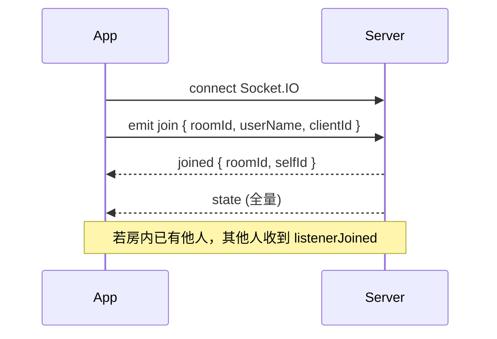

# Together Listen — App 对接接口说明

本文档面向 **原生 App / 第三方客户端** 开发，描述与 Together Listen 服务端通信的 HTTP 与 Socket.IO 协议。Web 页实现见 `public/app.js`，行为以服务端 `server.js` 为准。

## 1. 基础信息

| 项 | 说明 |
|----|------|
| 默认端口 | `3847`（环境变量 `PORT`） |
| HTTP 基址 | `http(s)://<host>:<port>/` |
| Socket.IO | 与 HTTP 同源；建议 `transports: ["websocket", "polling"]` |
| 默认房间 ID | `"reserved"`（省略或空字符串时） |
| 房间 ID 长度 | 服务端截断至 **32** 字符 |
| 播放队列上限 | **100** 首（`MAX_QUEUE_SIZE`） |
| 房间歌单 / 喜欢 | 各列表最多 **100** 条；房间歌单最多 **20** 个 |
| 昵称 | 1～24 字，去 `\r\n\t`；**全站唯一**（同名不同设备会冲突） |
| `clientId` | 客户端持久 UUID（≤64 字），用于同昵称同设备重连顶替旧 Socket |

### 1.1 同步播放模型

房间维护播放锚点：

- `anchorPosSec`：锚点位置（秒）
- `anchorWallMs`：锚点对应墙钟时间（毫秒）
- `isPlaying`：是否在播

客户端根据本地 `Date.now()` 推算当前应在的进度：

```text
若 isPlaying：
  positionSec = anchorPosSec + (Date.now() - anchorWallMs) / 1000
否则：
  positionSec = anchorPosSec
```

收到 `state` 后对齐本地播放器；拖动进度、暂停、切歌等操作通过 Socket 上报，由服务端广播。

### 1.2 曲目对象 `Track`

队列、房间歌单、喜欢列表通用：

```json
{
  "url": "/api/netease/stream/123456789",
  "title": "歌名 — 歌手",
  "neteaseId": 123456789,
  "source": "netease"
}
```

| 字段 | 类型 | 说明 |
|------|------|------|
| `url` | string | 播放地址；网易曲多为同源 `/api/netease/stream/:id` |
| `title` | string | 展示标题 |
| `neteaseId` | number | 可选，网易歌曲 ID |
| `source` | string | 可选，如 `"netease"`、`"url"` |

---

## 2. Socket.IO

### 2.1 连接

```javascript
import { io } from "socket.io-client";

const socket = io("https://your-host:3847", {
  transports: ["websocket", "polling"],
});
```

### 2.2 客户端 → 服务端（emit）

| 事件 | 参数 | 说明 |
|------|------|------|
| `join` | `{ roomId, userName, clientId }` 或房间 ID 字符串 | 进入房间；需先有效昵称 |
| `leaveRoom` | — | 离开当前房间 |
| `setDisplayName` | `{ name, clientId? }` 或字符串 | 设置昵称；已进房会广播 `state` |
| `userOp` | `{ action, detail?, ts? }` | 可选，操作日志（调试） |
| `play` | — | 从当前锚点继续播放 |
| `pause` | — | 暂停并冻结进度 |
| `seek` | `number`（秒） | 跳转进度 |
| `next` / `prev` | — | 下一首 / 上一首 |
| `select` | `number` | 播放队列中指定下标 |
| `setPlayMode` | `{ mode }` 或 `"loop"` / `"random"` | 循环 / 随机 |
| `setVolume` | `number` 或 `{ volume }` | 房间音量 `0～1` |
| `trackNaturalEnd` | `{ atIndex }` | 本端音频自然结束；`atIndex` 须与服务器 `currentIndex` 一致 |
| `addTrack` | `{ url, title? }` | 直链加队 |
| `addNeteaseTrack` | `{ id, title? }` | 单首网易加队 |
| `addNeteaseTracks` | `{ tracks: [{ id, title? }, ...] }` | 批量加队 |
| `addNeteasePlaylist` | `{ playlistId }` | 导入网易歌单到队列 |
| `playNeteaseNow` | `{ id, title? }` | 立即播放网易曲 |
| `playNeteaseTracks` | `{ tracks: [...] }` | 播放第一首，其余顺序入队 |
| `removeTrack` | `number` | 删除队列下标 |
| `removeTracks` | `{ indices: number[] }` | 批量删除 |
| `clearQueue` | — | 清空队列 |
| `moveTrack` | `{ index, direction: "up" \| "down" }` | 调整顺序 |
| `playStatTrack` | 曲目相关 | 从统计播放 |
| `createRoomPlaylist` | `{ name }` | 创建房间歌单 |
| `renameRoomPlaylist` | `{ playlistId, name }` | 重命名 |
| `deleteRoomPlaylist` | `{ playlistId }` | 删除歌单 |
| `addRoomPlaylistTrack` | 曲目字段 | 往房间歌单加歌 |
| `removeRoomPlaylistTrack` | `{ playlistId, index }` | 从歌单移除 |
| `addRoomFavorite` | 曲目字段 | 房间喜欢 |
| `removeRoomFavorite` | `number` | 取消喜欢 |
| `playRoomExtra` | `{ list, playlistId?, index }` | 播放歌单/喜欢中的曲目 |

### 2.3 服务端 → 客户端（on）

| 事件 | 载荷 | 说明 |
|------|------|------|
| `joined` | `{ roomId, selfId }` | 进房成功；`selfId` 为本连接 Socket ID |
| `leftRoom` | `{ roomId }` | 已离开房间 |
| `joinError` | `{ message }` | 进房失败（昵称冲突等） |
| `sessionReplaced` | `{ message }` | 同 `clientId` 新连接顶替本连接 |
| `state` | 见 **2.4** | 房间全量状态（进房、操作、广播后） |
| `togetherListen` | 见 **2.5** | 同听时长（两人及以上时周期性更新） |
| `listenerJoined` | 见 **2.6** | **新听众进房**（仅发给房间内其他人） |
| `displayNameOk` | `{ name }` | 昵称设置成功 |
| `displayNameError` | `{ message }` | 昵称无效或已被占用 |
| `errorMsg` | `{ message }` | 操作失败提示 |
| `infoMsg` | `{ message }` | 操作成功提示 |

### 2.4 `state` 载荷

```json
{
  "roomId": "myroom",
  "queue": [ { "url": "...", "title": "...", "neteaseId": 1, "source": "netease" } ],
  "currentIndex": 0,
  "isPlaying": true,
  "anchorWallMs": 1716000000000,
  "anchorPosSec": 12.5,
  "currentUrl": "/api/netease/stream/123",
  "currentTitle": "歌名",
  "listenerCount": 2,
  "members": [
    { "id": "socketId", "name": "小寒", "online": true }
  ],
  "playMode": "loop",
  "volume": 1,
  "togetherWithPeers": [],
  "roomPlaylists": [],
  "roomFavorites": [],
  "recentPlays": [],
  "topPlays": []
}
```

| 字段 | 说明 |
|------|------|
| `currentIndex` | 当前曲在 `queue` 中的下标；无曲为 `-1` |
| `currentUrl` / `currentTitle` | 当前播放曲目（由 `currentIndex` 推导） |
| `members` | 在线听众列表（按昵称排序） |
| `togetherWithPeers` | 与「我」的同听统计，见 2.5 |
| `volume` | 房间共享音量 `0～1` |

**App 建议**：收到 `state` 且 `playback` 变化（`currentUrl` / `currentIndex` / `isPlaying`）时重载音频源；仅 `anchor` 变化时 seek；仅 `volume` 变化时不要打断播放。

### 2.5 `togetherListen` 载荷（局部更新）

```json
{
  "listenerCount": 2,
  "members": [ { "id": "...", "name": "...", "online": true } ],
  "togetherWithPeers": [
    {
      "otherName": "同伴昵称",
      "sessionMs": 120000,
      "totalMs": 3600000,
      "otherOnline": true
    }
  ]
}
```

- 房间内 **≥2 人** 时，服务端每秒累计同听时长，约 **每 3 秒** 广播一次（计时仍每秒累加）。
- `sessionMs`：本场会话累计；全员离开后清零。
- `totalMs`：历史累计（持久化在 `data/pair-listen.json`）。

可合并进本地 `state`：`state = { ...state, ...partial }`。

### 2.6 `listenerJoined` 载荷（进房提醒）

当房间内 **已有其他听众** 时，新用户 `join` 成功后，**仅其他在线成员** 会收到：

```json
{
  "roomId": "myroom",
  "userName": "新来的昵称",
  "listenerCount": 3,
  "joinedAt": 1716000000000
}
```

| 字段 | 说明 |
|------|------|
| `userName` | 新进房者昵称 |
| `listenerCount` | 进房后房间在线人数（含新进房者） |
| `joinedAt` | 服务端时间戳（毫秒） |

**App 建议实现**：

1. 播放短提示音（Web 端约 880Hz→660Hz、0.4s；可用系统通知音替代）。
2. 展示弹窗/横幅：「`userName` 进入了房间」，**5 秒后自动关闭**。
3. 进房者本人 **不会** 收到此事件。
4. 房间内第一个听众进房时，无人在线可通知，故无 `listenerJoined`。

---

## 3. HTTP API

除静态资源外，主要接口如下。错误时多为 `{ "error": "..." }`，HTTP 4xx/5xx。

### 3.1 管理调试（需 `ADMIN_TOKEN`）

| 方法 | 路径 | 说明 |
|------|------|------|
| GET | `/api/admin/status` | 是否启用管理功能 |
| GET | `/api/admin/logs?since=&limit=` | 操作日志 |
| GET | `/api/admin/stats` | CPU / 内存 / 网络等 |

鉴权：Query `token=`、Header `X-Admin-Token` 或 `Authorization: Bearer <token>`。

### 3.2 网易云代理

| 方法 | 路径 | 说明 |
|------|------|------|
| GET | `/api/netease/status` | 登录状态 |
| POST | `/api/netease/cookie` | Body `{ "cookie": "..." }` 保存 Cookie |
| POST | `/api/netease/logout` | 清除 Cookie |
| POST | `/api/netease/login/qr/start` | 开始扫码登录 |
| GET | `/api/netease/login/qr/check?key=` | 轮询扫码结果 |
| GET | `/api/netease/search?q=&type=&limit=` | 搜索；`type`: `song`（默认）/ `playlist` / `lyric` / `artist` |
| GET | `/api/netease/search/playlists?q=` | 搜索歌单 |
| GET | `/api/netease/playlists` | 当前账号歌单 |
| GET | `/api/netease/xiaoyan/playlists` | 小彦歌单列表 |
| GET | `/api/netease/xiaoyan/comments?limit=&time=` | 小彦评论 |
| GET | `/api/netease/playlist/:id` | 歌单曲目列表 |
| GET | `/api/netease/stream/:id` | **音频流代理**（支持 `Range`，用于播放器） |

**播放网易歌曲**：队列中 `url` 设为 `/api/netease/stream/<songId>`，播放器请求：

```text
GET https://<host>/api/netease/stream/123456789
Range: bytes=0-   （可选，用于 seek）
```

### 3.3 静态页面

| 路径 | 说明 |
|------|------|
| `/` | Web 主站 |
| `/admin.html` | 管理调试页 |

---

## 4. App 进房流程（推荐）



1. 持久化 `clientId`（UUID）与 `userName`。
2. 连接 Socket.IO，监听 `state`、`listenerJoined`、`sessionReplaced`、`disconnect`。
3. `emit("join", { roomId, userName, clientId })`，等待 `joined` 与首包 `state`。
4. 用 `state.currentUrl` 加载音频；`isPlaying` 为真时按锚点推算进度并播放。
5. 音频自然结束时 `emit("trackNaturalEnd", { atIndex: state.currentIndex })`（防重复上报见 Web 端 `naturalEndReportedAnchorMs` 逻辑）。
6. 离开页面时 `emit("leaveRoom")` 或断开连接。

---

## 5. 播放同步要点（避免卡顿 / 无声）

| 场景 | 建议 |
|------|------|
| 收到 `state` 仅音量变化 | 只更新音量，不 seek、不重载 |
| 收到 `state` 切歌 | 换源后等 `canplay` 再 `play()`；大偏差用 ≥2.5s 阈值 + 冷却校正 |
| 曲终等待服务器 | 勿对旧曲反复 `seek(0)`；等 `currentIndex` / `currentUrl` 变化后再加载新曲 |
| 进度条在走但无声 | 多为本地未 `play()`；对照 `isPlaying` 与播放器 `paused` |
| 浏览器 / WebView | 需用户手势解锁音频；可提示点击播放按钮 |

---

## 6. 环境变量（运维）

| 变量 | 默认 | 说明 |
|------|------|------|
| `PORT` | `3847` | 监听端口 |
| `HOST` | `0.0.0.0` | 绑定地址 |
| `PUBLIC_SITE_ORIGIN` | `https://wannian.fun` | 分享链接主站 |
| `SOCKET_CORS_RELAXED` | `1` | `0` 时 Socket 仅允许白名单来源 |
| `EXTRA_ORIGINS` | — | 额外允许的 CORS 来源 |
| `ADMIN_TOKEN` | — | 配置后启用 `/admin.html` |
| `ROOM_EXTRAS_STORE_FILE` | `data/room-extras.json` | 房间持久化路径 |
| `PAIR_LISTEN_STORE_FILE` | `data/pair-listen.json` | 同听累计路径 |

---

## 7. 版本与联系

- 仓库实现：`server.js`（协议）、`public/app.js`（Web 参考客户端）
- 本文档随功能更新；**进房提醒** `listenerJoined` 自 2026-05 起提供

如有新 Socket 事件或字段变更，以 `server.js` 中 `socket.on` / `emit` 为准。
